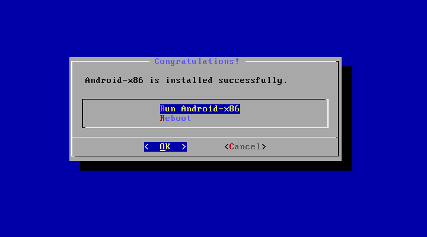
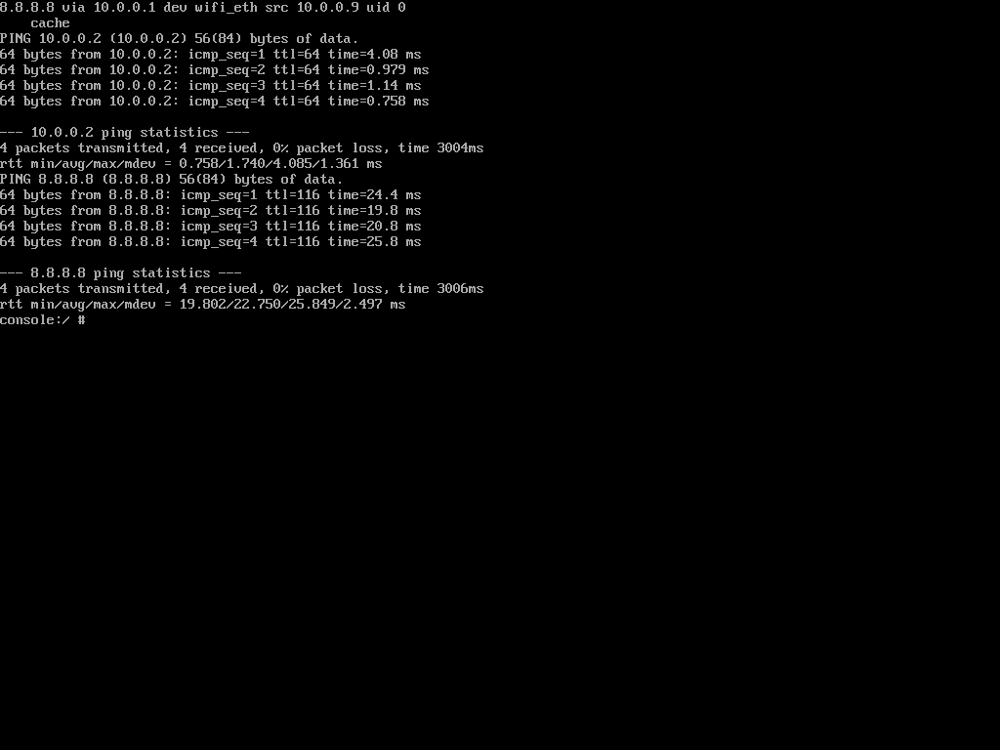
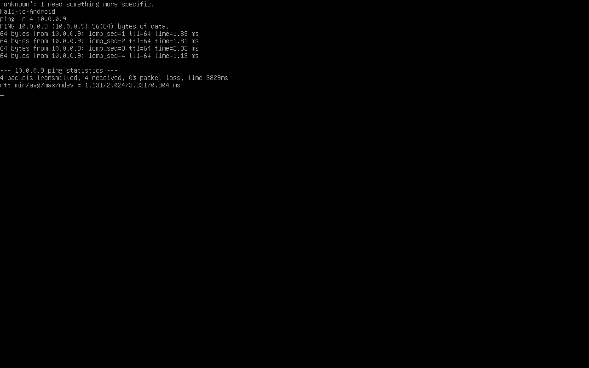

# Week 1 Android-x86 VirtualBox Lab

Installed Android-x86 9.0-r2 (64-bit) on a fresh 16 GB dynamically allocated VDI with 2 GB RAM. Android and Kali share the VirtualBox NAT Network.

| Test | Result |
|---|---|
| Android to Kali | 4 sent, 4 received, 0% loss |
| Kali to Android | 4 sent, 4 received, 0% loss |
| Android to internet (8.8.8.8) | 4 sent, 4 received, 0% loss |

The VM initially aborted because its virtual disk file was missing. I attached a replacement disk, created an ext4 partition, installed GRUB and removed the ISO after installation. A blank display after boot was resolved with VBoxVGA, 128 MB of video memory and 3D acceleration disabled.

This build exposes its physical Ethernet interface as `wifi_eth`. I set Android to `10.0.0.9/24` and the gateway to `10.0.0.1`, then added a routing rule so Android could use the main route table. These settings were applied for the running session. Persistence after reboot and DNS resolution were not verified. Kali used `10.0.0.2/24`.

